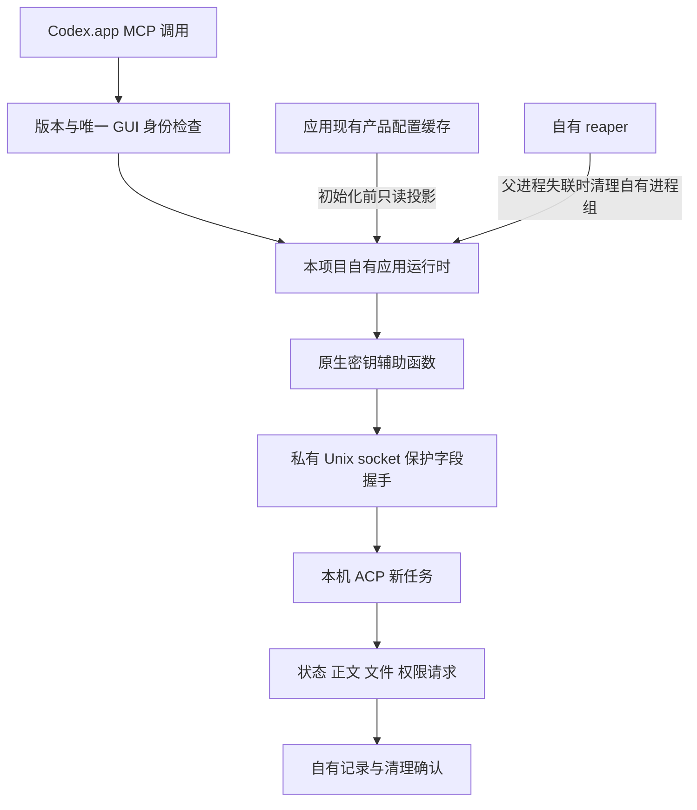

# 冷启动设计

更新：2026-10-13。适配 Intel Mac、macOS 26.5.1、WorkBuddy **5.6.2 / 5.7.7**。本文描述 v0.1.1 的原创桥接实现；应用内部代码仅在本机研究，仓库不含解包代码、原生密钥或用户凭证。

## 为什么需要新的启动路径

WorkBuddy GUI 已登录，不保证 sidecar 或 CLI Host 已启动。alpha.2 只能发现已有通道，整个应用退出后无法恢复任务入口。alpha.3 在实际任务启动时创建自己的应用内置运行时；只读诊断保持不启动模型任务。

已有 sidecar 可用时仍采用相应通道。冷启动不伪造桌面会话，不直接写 WorkBuddy 历史数据库，不接管用户已有任务。

## 启动与受保护登录

1. 核验应用版本、Intel 可执行文件和唯一真实 GUI 主进程，以 PID 与启动身份识别这次应用生命周期。未知版本、多个 GUI 或身份不明确时拒绝任务。
2. 创建带本项目任务身份的独立 worker 与进程组，使用应用自带 Electron 和 lite 运行时。环境只继承所需系统变量，不继承外部模型 API key、旧 bootstrap 或 Node 覆盖参数。
3. 本项目 launcher 在应用内置运行时中调用应用现有原生保护接口和密钥辅助函数，使用 `createIfMissing=false`。不存在可用保护材料时明确失败，不创建新账号密钥，不关闭静态字段加密。
4. 临时目录权限为 `0700`，由自有运行时使用私有 Unix socket 完成保护字段与就绪握手；校验当前用户、任务身份、PID、一次性握手标识及协议。原生保护材料不进入 Python、命令行参数、日志、任务记录或文档，也不读取或导出裸 token。Python 仅管理本机运行时和自己的临时网关认证。
5. 握手完成后初始化 ACP，确认指定模型和会话预算，再提交一次 prompt。初始化/模型目录失败不发送 prompt；启动参数不提前固定模型，避免旧目录快照。

这是一套依赖已安装应用内部接口的适配，不是公开稳定 API。实际云端短任务成功证明该执行路径能够完成认证；积分归属与扣减需另外由用户核对用量页。

## 产品配置投影

应用维护的 `~/.workbuddy/cache/acc-product-config-v3.json` 决定产品、模型及工具配置。只传文件路径可能晚于 CLI 初始快照解析，造成模型或 Bash 能力仍使用旧配置。

Python 仅核对缓存路径与文件元数据。原生 launcher 使用禁止跟随符号链接的只读方式加载缓存，检查用户归属、写权限、大小和 WorkBuddy 认证类型，在 CLI 初始化前内联投影到本项目进程环境。缓存不改写、不复制入仓库、不打印其正文；应用配置和全局默认模型保持原有设置。

此修复后，双模型短任务、1m 会话预算和明确 Bash `allow_once` 均通过。工具配置投影不等于所有桌面 MCP 已继承；通达信、同花顺和目标法律工具仍属于 #5 的缺口。

## 生命周期与清理

- 同时执行一个任务。相同 `request_id` 与完全相同参数返回原记录；输入变化报错，响应丢失或服务重启不能造成静默重发。
- GUI 生命周期消失或自有 worker 意外结束后，任务进入 `uncertain`。等待权限会被唤醒，保留已收到的部分正文和文件结果，不冒充用户取消，也不晚到覆盖为成功。
- 自有 reaper 只持有本项目进程组的清理职责，不持有凭证或模型能力。父进程失联或正常终止时，只针对已验证的自有组处理残留子进程；不向用户 GUI、sidecar 或其他任务发强制终止信号。
- 持久化 `cleanup_pending` 与 `cleanup_confirmed`。任务结束不等于清理完成；服务重启继续处理未确认清理的自有资源，保留原终态，不重新提交模型。
- 权限请求传回用户，保持 `allow_once` / `reject_once` 等显式选择；不自动开启 fullAccess 或永久允许。单次等待最多 60 秒，等待超时不取消任务。

## 健康检查怎样解释

| 字段 | 含义 |
| --- | --- |
| `bridge_version=0.1.1` | 确认实际加载正式版桥接服务代码；与 WorkBuddy 应用版本分开。原生验收时已确认过同一功能代码的 `0.1.0a3` |
| `ready_for_task=true` | 安装、版本和 GUI 等启动条件满足，可以尝试创建任务 |
| `runtime_ready=false` | 还没有可直接使用的运行通道，任务启动时才创建自有 worker |
| `authenticated=null` | 只读检查尚未验证认证，不代表登录失败或云端认证成功 |
| `runtime_ready=true`、`authenticated=true` | 已运行通道的本机认证可用；仍不能替代模型任务完成与用量核对 |
| `available=false` | 按公开错误处理，先修复条件再启动任务 |

冷启动只读 health 不读取保护材料、不启动 worker、不调用模型。更新代码后须重新加载 MCP 或完全重启 Codex，确认调用的是新服务。

## 更新维护与验收

当前严格适配 WorkBuddy 5.6.2、5.7.7；5.7.6 未完成验收。更新应用后先保持未知版本拒绝任务，再复核入口路径、原生保护接口、私有握手、产品配置结构、模型选择和 GUI 身份；完成自动回归及独立目录真实矩阵后才加入支持版本。

alpha.3 已完成双模型、文件/Bash 权限、目录外拒绝、流式取消、错误本机凭证、worker 失联、MCP 强制结束/重启，以及流式和权限等待时的整个 GUI 退出/重开。原任务 uncertain、请求不重发、新自有任务成功和清理确认均通过。本机及 Intel/Ubuntu 云端 232 项自动测试通过；用户完全重启 Codex 后，一次原生健康检查确认加载同功能的 0.1.0a3；WorkBuddy 用量页核对新路径七条 2.88 积分，其余请求消耗未知。v0.1.0 仅变更版本与文档。证据与历史失败见 [测试报告](TEST_REPORT.md)，版本范围见 [兼容表](COMPATIBILITY.md)。

5.7.7 的原生短名映射、产品缓存跳读和账号模型门槛、保护握手等待、后台清理刷新及两种整 GUI 恢复验收见 [适配记录](WORKBUDDY_5_7_7.md)。跳过旧缓存读取不等于禁止应用常规缓存写入；本次 Codex 原生 MCP 待完全重启确认。
